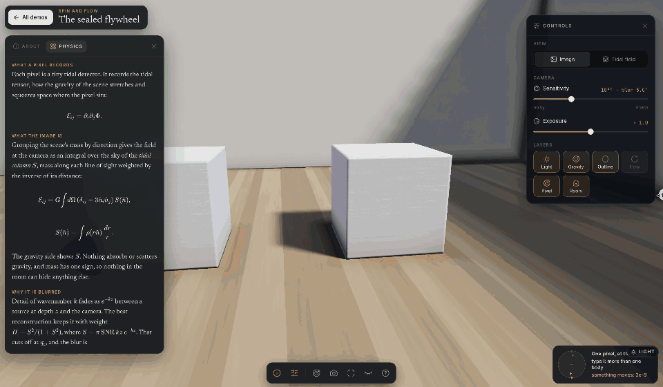

# Gravitational Camera

_A thought experiment_



What would a camera see if every pixel were an ideal, arbitrarily small detector of gravitational waves and tidal
fields?

This repository works the question out in full: a theory of how such a camera forms images, a paper that sets it out
with derivations and figures, an engine that renders everyday scenes and the sky through it, and an independent
reference implementation that checks every number. All of it is published as one website.

**[Website](https://neovand.github.io/gravitational-camera/)** ·
**[Paper (PDF)](https://neovand.github.io/gravitational-camera/gravitational-camera.pdf)** ·
**[Demos](https://neovand.github.io/gravitational-camera/demo/)**

## The idea

LIGO is a camera with one pixel: an instrument kilometres long that reports a single number at each instant. Suppose
such detectors could be made as small and as sensitive as we please, and laid out as a sensor. Gravity is produced by
everything and stopped by nothing, so the camera's pictures are unlike any taken with light. They are also
calculable, because gravity is simple where it is weak: the linear theory, and the stress and motion of the matter in
view, decide everything.

## What it finds

- **A pixel measures the tidal field**, ten numbers at each point: the electric part $\mathcal{E}_{ij}$ and the
  magnetic part $\mathcal{B}_{ij}$ of the curvature. One component of it, which is all an interferometer reads, cannot tell a
  passing wave from the pull of a passing lorry, and for everyday scenes the pull dominates.
- **Three regimes**, set by the distance to the source against a sixth of its wavelength and by how fast it moves: the
  near field, waves from bulk motion, and the thermal glow of matter.
- **In the near field the camera sees mass itself, through any wall, but blurred.** The blur is fixed by the logarithm
  of the sensitivity: $\Delta\theta = 4.43/q_c$ with $q_c e^{-q_c} = 1/(\pi\,\mathrm{SNR})$, that is $24^\circ$ at a
  signal-to-noise ratio of a thousand and still $3.4^\circ$ at $10^{30}$. A blurred image is not a vague measurement:
  a simple scene, or one whose mass cannot be negative, is measured far more sharply than it can be drawn, and a single
  mass is placed to within a millimetre at a metre while its image is $24^\circ$ wide.
- **In the waves of moving bodies, a compact body is a point**, since its wavelength exceeds its size by $(\pi/2)\,c/v$.
  The point still tells which way the body turns, from its polarization.
- **In the thermal glow, matter is transparent and self-luminous**: each pixel sums the glow along its whole line of
  sight, so the Sun's core shines through the Earth at midnight. The glow is set by a material's friction at the
  frequencies of heat, and it is faint: the whole Earth below delivers at most one graviton per square metre every
  twenty hours, however generous one is to its materials.
- **There are no usable lenses, mirrors or shadows** short of a black hole; images are computed, not focused.
- **One pixel measures more than one might think.** It records ten numbers: four that no observer can change, three
  that orient the field and three that give the velocity of its rest frame. So it determines its own velocity
  through an unknown scene, and is a test for relative motion within it (its eigenvalues turn complex); every
  reading has four principal null directions, against two for light. It points back to a single wave,
  $\hat n = -\epsilon_{ijk}\mathcal{E}_{jl}\mathcal{B}_{kl}/|\mathcal{E}|^2$, gives a moving body's whole state
  exactly, and ranges a moving mass, $r = c\,|\mathcal{B}\hat n|/|P\dot{\mathcal{E}}\hat n|$, because the magnetic
  part supplies the scale the electric part lacks. It separates up to four crossing waves where a sensor of light
  separates two, ranges a wave source, sees moving bodies where they are now, and reads the speed and all six
  polarizations of any metric wave. For a sky of many sources it sees only the spherical harmonics of degree four and
  below: twelve sources at the corners of an icosahedron look to it exactly like a uniform sky.
- **In astrophysical and cosmological scenes**, the field of a pair of black holes changes from Newton's pull to
  waves at a sixth of their wavelength; the Galaxy's centre, hidden from light by thirty magnitudes of dust, is the
  brightest part of the millihertz sky; if the early universe was ever hot enough, the whole sky glows at
  $0.905\,\mathrm{K}$, and the only shadows on it are black holes; the transparent Sun focuses gravitational waves
  only above about $8\,\mathrm{kHz}$.
- **The exterior field and the interior: gravitational hair.** The field outside a body at one time fixes only the
  harmonic moments of its mass; the field at two times, its thermal tremor or its response to an applied tide, fixes
  all of it, through the same logarithm. A black hole gives away seven numbers at one time and only its temperature
  at two. The second reading can be an impulsive tide and a weighing: the weight alone, after enough impulsive tides
  applied from outside, gives the whole density. How much is reached depends on the tide: tides of degree up to $m$
  give $m$ radial moments of the density in every angular sector and no more, so there are bodies that no
  quadrupolar tide tells apart and an octupolar tide does; two tides in either order give the flow inside the body.

This is a thought experiment, not a proposal for an instrument. The paper ends with a conclusion and the problems
that remain open; an appendix says where each of its results is checked.

## The demos

Every demo shows the same scene twice, one half in light and the other in gravity, with a divider to drag.

| Demo                                 | Regime     | What it shows                                                                               |
| ------------------------------------ | ---------- | ------------------------------------------------------------------------------------------- |
| The Sun at midnight                  | thermal    | The Earth's layers, and the Sun's core through the planet                                   |
| The locked safe                      | near field | Gold inside a steel safe; the blur set by sensitivity                                       |
| Full or empty                        | near field | Weighing by looking                                                                         |
| The blank mirror                     | near field | Reflections, pictures and print carry next to no mass                                       |
| The sealed flywheel                  | near field | The flow inside a sealed body, in the magnetic part                                         |
| A beam in the dark                   | near field | A beam of light, invisible from the side, gravitates                                        |
| Where it is now                      | near field | Light shows a flying ball where it was, gravity where it is (light slowed, and labelled so) |
| Behind the wall                      | near field | Two people behind a wall; one walks, and the flow and a single pixel show it                |
| The closed furnace                   | thermal    | The temperature inside a closed box                                                         |
| Honey and water                      | thermal    | Glow set by friction at the frequencies of heat, not viscosity: honey glows near water      |
| Which way it turns                   | waves      | The sense of rotation inside a sealed drum, from polarization                               |
| The Milky Way                        | sky        | The Galaxy's centre through its dust                                                        |
| A black hole against the first light | sky        | Exact Schwarzschild rays; the only shadow in the graviton sky                               |
| Two black holes, inside out          | sky        | The field of an orbiting pair, from Newton's pull to waves                                  |

Two demos slow light down, and say so wherever it is slowed: until the waves are centimetres long, or until its
delay can be seen across a room.
Material properties that are assumptions are labelled in each scene file and on the page.

## Interactive figures

Seven of the paper's figures on what a single pixel measures are also live, under their figures in the online paper
and on their own at **[/figures](https://neovand.github.io/gravitational-camera/figures/)**: the principal null
directions of one reading, four waves separated by one pixel, the camera sees the present, a pixel's own velocity and
the test for motion, ranging a wave source, the sky at one pixel, and beyond general relativity in one reading.
Two more stand on their own there. In "Push and weigh", two bodies with the same field outside are given tides of
rising degree and weighed, until one degree tells them apart (Section XII, whose figure of those two bodies links
to it in the online paper). "A ring of marked particles" is not in
the paper: a ring of free particles in an exact gravitational plane wave, whose marks turn against a gyroscope by
half the area that the ring's shape sweeps in the hyperbolic plane.

## The repository

| Path                          | What it is                                                                                                                               |
| ----------------------------- | ---------------------------------------------------------------------------------------------------------------------------------------- |
| `app/`                        | The website: SvelteKit, TypeScript, WebGPU. The engine is in `app/src/lib/engine/`, the paper's page in `app/src/routes/paper/`.         |
| `paper/`                      | The paper in REVTeX 4.2 (Physical Review D, two columns). The site renders the same LaTeX with pandoc.                                   |
| `paper/figures/`              | The figures, as PDF for print and SVG for the site. `make_figures.py` draws the charts and renders from the reference implementation.    |
| `figures3d/`                  | The figures modelled in 3D: three.js for the geometry, a small renderer of our own that writes vector SVG, labels set in TeX by MathJax. |
| `reference/`                  | An independent Python implementation of the physics, with its tests. It exports the fixtures the engine is checked against.              |
| `scenes/`                     | Scene files shared by the engine and the reference; the format is in `scenes/README.md`.                                                 |
| `design/`                     | How figures are made (`FIGURE_WORKFLOW.md`, `FIGURE_PLAN.md`) and the image-model tools used for style references and illustrations.     |
| `reports/`, `research_notes/` | The survey of prior work and its notes.                                                                                                  |

## Building it

The `Makefile` at the root does all of it:

```bash
make doctor   # checks Python, Node, pandoc, TeX and poppler, and says how to install what is missing
make setup    # .venv with the reference implementation, the site's packages, the test browser
make dev      # the site at http://localhost:5173
make test     # everything CI runs
make paper    # paper/main.pdf
```

`make help` lists the rest (`figures`, `build`, `fixtures`, `clean`, ...). The steps it runs are these:

**The site** needs Node 22 or later, pnpm and pandoc:

```bash
cd app
pnpm install
pnpm dev
```

The engine needs a browser with WebGPU; without one, pages fall back to still images.

**The reference implementation** needs Python 3.11 or later:

```bash
cd reference
python -m pip install -e '.[test]'
python -m pytest
```

**The paper** needs TeX Live with the publishers' classes (for REVTeX):

```bash
cd paper
latexmk -pdf main.tex
```

**The figures** come from two places. The charts and renders are drawn from the reference implementation; the figures
modelled in 3D take their charts from the first step:

```bash
python3 paper/figures/make_figures.py
python3 paper/figures/charts.py
cd figures3d && npm install && node render.mjs --final tidal sky-integral quadrupole line-integral earth-glow \
  ladder two-readings hidden-flow near-field-geometry
```

## Checks

```bash
cd app
pnpm run check             # types
pnpm run lint
pnpm exec vitest --run     # the engine's physics against reference/fixtures
pnpm exec playwright test  # the pages, and the shaders against the reference
```

The end-to-end tests run the shaders on a software WebGPU adapter and compare them with the Python reference; the same
comparison runs in any browser at `/dev/selftest/`. Every push to `main` runs the tests, builds the PDF and the site,
and deploys them to GitHub Pages.

## Author and credits

Mostafa ‘Neo’ Mohsenvand, with Claude.

The Earth's surface in the paper's figures is NASA's Blue Marble, by way of the three.js examples. The site is set in
Newsreader, Inter and JetBrains Mono, with icons from Hugeicons. The illustrated objects in one figure were drawn with
an image model and are marked as illustrations in its caption; every mark that carries a number is drawn by code.
